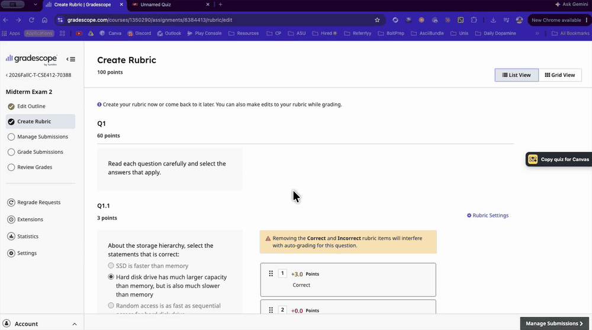

# Gradescope to Canvas

A Chrome extension that moves quiz questions into Canvas: from a Gradescope quiz, or from another Canvas quiz. The questions, the answer key, the points, the math and the figures all come along.

<p align="center"></p>

If you've ever rebuilt an exam in Canvas by hand, you know the drill. Retype every question, re-mark every answer, re-upload every figure, fix whatever the math turned into. This does it in about a minute, and it all happens in your own browser, so there's no server to run and no API token to create.

## Using it

**From Gradescope**

1. Open the assignment's **rubric page** and click **Copy quiz for Canvas** (the dark tab on the right edge). Tick the questions you want, a whole section at a time if you like, and click **Copy**.
2. Want questions from another Gradescope quiz in the same Canvas quiz? Do the same there. Each copy is added to the last.
3. In Canvas, open the target quiz's **Edit** page, click **Copy or import**, then **Import into this quiz or a bank**.
4. Check the preview and click **Import**. Then reload the page.

**From another Canvas quiz**

On the quiz you're copying from, click **Copy or import**, then **Copy from this quiz** and tick the questions. Open the other quiz and import the same way. You can mix Gradescope and Canvas questions in one import.

**In the preview**

It starts simple: a list of questions with checkboxes. Anything beyond that is one click away.

- **Change** lets you send the questions to a question bank instead of the quiz.
- **Edit order and points** adds arrows to reorder, a points box per question (or for all selected at once) and a way to rename a quiz.
- Questions already in the quiz are skipped unless you tick them to be replaced.

**Changed your mind?** Click **Copy or import**, then **Undo an import**. It removes only what that import added and puts back anything it replaced. Questions you made by hand are never touched.

The quiz title, settings and publishing are always left to you.

## What comes across

- Multiple-choice and select-all questions, with the correct answers and point values.
- Math, as Canvas equations. Code that was typed as math (SQL, in the exam this was built on) becomes a proper code block.
- Figures, uploaded to a hidden folder in the course files so students can't browse them.
- Text shared by a whole section, like a scenario or a schema. Canvas has no shared-text block, so you choose whether to repeat it on each question. Short generic instructions are left off by default.
- From another Canvas quiz: multiple choice, select-all, true/false, fill in the blank, essay and text-only, with their feedback. Matching, numerical and other types are listed as not copied. Figures stored in a different course won't show in the new one.

Before anything is copied it checks that every question has an answer key and that question numbers are unique. Anything it can't copy is listed as "Not copied" instead of quietly disappearing. An import never deletes anything, and if the quiz already has other questions, new ones go at the end without reshuffling yours.

If something goes wrong, the message says what happened and what to try. **Copy diagnostics** gives you a short report (page type, step, error, no quiz content) to paste into an issue.

## Install

It isn't in the Chrome Web Store, so you load it yourself:

1. Open `chrome://extensions` and turn on **Developer mode**.
2. Click **Load unpacked** and pick the `extension/` folder.

The extension is set up for `canvas.asu.edu` and `*.instructure.com`. If your school uses another Canvas address, add it to the Canvas entry under `content_scripts` in `extension/manifest.json`, then reload the extension.

## Privacy

Your questions go from one tab to the other through `chrome.storage` in your browser and nowhere else. A short record of what each import created is kept there too, so it can be undone. The extension acts through the sessions you're already signed in to. Its only host permission is Gradescope, to download figures, because a web page can't read those itself.

## Good to know

- Question banks use the same routes Canvas's own pages use, not the public API, so a Canvas update could break that part. Quizzes use the public API.
- Canvas **classic** quizzes only, not New Quizzes.
- It has been tried on one real exam. Select-all, banks and Canvas-to-Canvas copying are tested on made-up data and a few small real runs, so expect some rough edges, and open an issue if you find one.

## Development

No dependencies. `node test/run.js` runs the tests: extraction, the importer, validation, undo, banks, error messages and the manifest.

```
extension/lib/            the logic, with no Chrome APIs so it can be tested
extension/content/        the buttons and dialogs on each site
extension/background.js   downloads figures from Gradescope
```

The logo is `extension/icons/logo.svg`. The 16px icon has its own simplified drawing, `logo-16.svg`, because the full one blurs at that size.

## License

MIT, see [LICENSE](LICENSE). Not affiliated with or endorsed by Gradescope, Canvas, Instructure or Arizona State University. Contributions are welcome, see [CONTRIBUTING.md](CONTRIBUTING.md).
